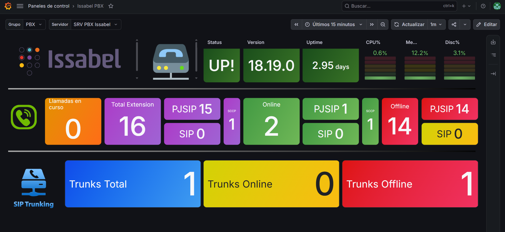

🌐 *Leer en [Inglés](README.md)*


# Monitoreo de Issabel PBX 5 con Zabbix y Grafana

Plantilla de Zabbix y dashboard de Grafana diseñados para monitorear el estado operativo de centrales telefónicas **Issabel PBX 5**, incluyendo extensiones (SIP, PJSIP, SCCP), troncales, llamadas activas y estado de servicios.

Por defecto, este dashboard filtra los equipos que pertenecen al grupo de Zabbix llamado PBX.



## 🛠️ Compatibilidad probada

| Componente | Versión |
| :--- | :--- |
| **Issabel PBX** | v5 |
| **Zabbix** | 7.0.32 |
| **Grafana** | v13.3.1 |

## 📋 Métricas incluidas
* **Extensiones:** Totales, en línea y desconectadas (desglosado por SIP, PJSIP y SCCP/Custom).
* **Troncales SIP:** Total registradas, activas (`OK`) y caídas (`UNREACHABLE`).
* **Tráfico y llamadas:** Llamadas activas en tiempo real.
* **Sistema y servicios:** Versión de Asterisk, *uptime* del sistema, tiempo desde el último *reload* y estado de los procesos `asterisk` y `zabbix_agent`.

---

## ⚙️ Requisitos previos en el servidor Issabel

### 1. Instalar UserParameters en Zabbix Agent
Copia el archivo [`agent/userparameter_asterisk.conf`](agent/userparameter_asterisk.conf) en el directorio de configuración del agente de tu servidor Issabel:

* **Para Zabbix Agent:** `/etc/zabbix/zabbix_agentd.d/userparameter_asterisk.conf`
* **Para Zabbix Agent 2:** `/etc/zabbix/zabbix_agent2.d/userparameter_asterisk.conf`

```

### 2. Permisos de ejecución para Zabbix
El usuario `zabbix` necesita permisos para conectarse a la consola de Asterisk (`/var/run/asterisk/asterisk.ctl`). Añade el usuario `zabbix` al grupo `asterisk`:

```bash
usermod -aG asterisk zabbix
```

*(Opcional)* Si tu instalación requiere `sudo` para ejecutar comandos de Asterisk, agrega la siguiente regla mediante `visudo`:
```text
zabbix ALL=(ALL) NOPASSWD: /usr/sbin/asterisk
```

### 3. Reiniciar el agente de Zabbix
Aplica los cambios reiniciando el servicio correspondiente:
```bash
systemctl restart zabbix-agent
# O si utilizas Zabbix Agent 2:
systemctl restart zabbix-agent2
```

---

## 🚀 Instalación en Zabbix y Grafana

1. **Zabbix (7.0.32):** Importa el archivo `.yaml` ubicado en `zabbix/` desde **Data collection > Templates > Import** y asígnalo al host de tu servidor Issabel.
2. **Grafana (v13.3.1):** Importa el archivo `.json` ubicado en `grafana/` desde **Dashboards > New > Import** y selecciona tu *Data Source* de Zabbix.
