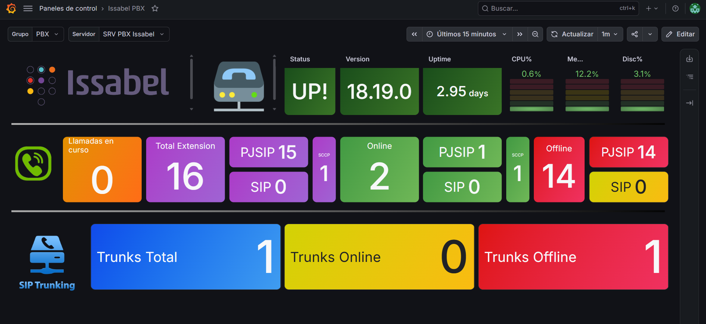

🌐 *Read this in [Spanish](README.es.md)*

# Issabel PBX 5 Monitoring with Zabbix & Grafana

Zabbix template and Grafana dashboard designed to monitor the operational status of **Issabel PBX 5** servers, including extensions (SIP, PJSIP, SCCP), trunks, active calls, and core service health.

By default, this dashboard filters hosts belonging to the Zabbix Host Group named PBX.



## 🛠️ Tested Compatibility

| Component | Version |
| :--- | :--- |
| **Issabel PBX** | v5 |
| **Zabbix** | 7.0.32 |
| **Grafana** | v13.3.1 |

## 📋 Included Metrics
* **Extensions:** Total, online, and offline counts (broken down by SIP, PJSIP, and SCCP/Custom).
* **SIP Trunks:** Total registered, active (`OK`), and unreachable (`UNREACHABLE`) trunks.
* **Traffic & Calls:** Real-time active calls.
* **System & Services:** Asterisk version, system uptime, time since last reload, and process status for `asterisk` and `zabbix_agent`.

---

## ⚙️ Prerequisites on the Issabel Server

### 1. Install Zabbix Agent UserParameters
Copy the [`agent/userparameter_asterisk.conf`](agent/userparameter_asterisk.conf) file into your Zabbix Agent configuration directory on the Issabel server:

* **For Zabbix Agent:** `/etc/zabbix/zabbix_agentd.d/userparameter_asterisk.conf`
* **For Zabbix Agent 2:** `/etc/zabbix/zabbix_agent2.d/userparameter_asterisk.conf`

You can also download it directly from your server terminal (replace `YOUR_USERNAME` and `YOUR_REPO`):

```bash
curl -o /etc/zabbix/zabbix_agentd.d/userparameter_asterisk.conf https://githubusercontent.com
```

### 2. Execution Permissions for Zabbix
The `zabbix` user needs permissions to query the Asterisk console (`/var/run/asterisk/asterisk.ctl`). Add the `zabbix` user to the `asterisk` group:

```bash
usermod -aG asterisk zabbix
```

*(Optional)* If your setup requires `sudo` to execute Asterisk CLI commands, add the following rule using `visudo`:
```text
zabbix ALL=(ALL) NOPASSWD: /usr/sbin/asterisk
```

### 3. Restart Zabbix Agent
Apply the configuration changes by restarting the service:
```bash
systemctl restart zabbix-agent
# Or if using Zabbix Agent 2:
systemctl restart zabbix-agent2
```

---

## 🚀 Zabbix & Grafana Setup

1. **Zabbix (7.0.32):** Import the `.yaml` template from the `zabbix/` directory via **Data collection > Templates > Import** and link it to your Issabel host.
2. **Grafana (v13.3.1):** Import the `.json` dashboard from the `grafana/` directory via **Dashboards > New > Import** and select your Zabbix Data Source.
