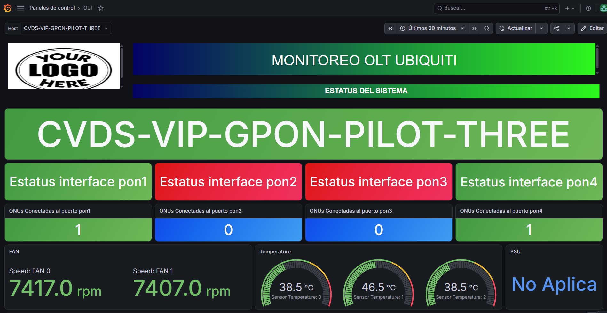
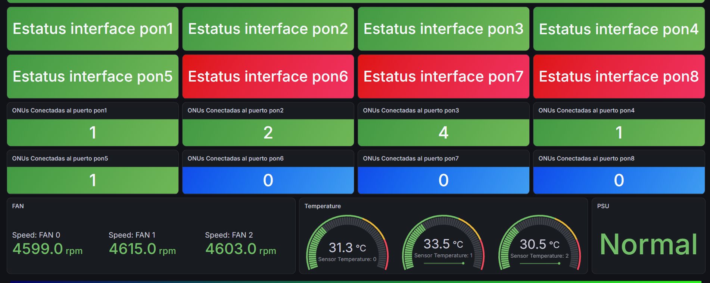
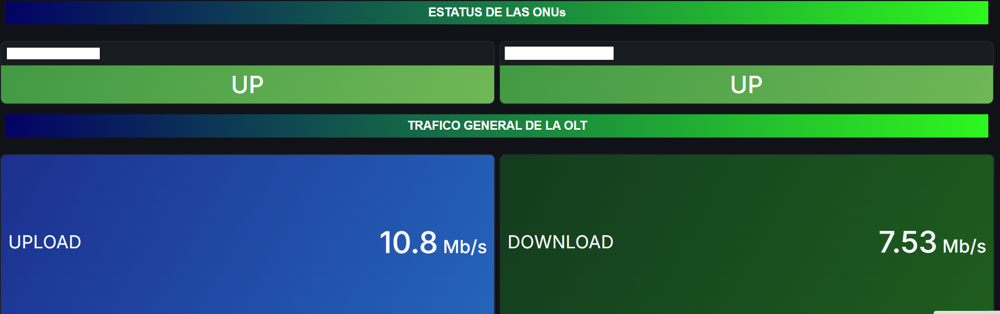

🌐 *Leer en [Inglés](README.md)*

# Monitoreo de Ubiquiti UFiber OLT (4 y 8 Puertos) con Zabbix y Grafana

Plantilla de Zabbix y dashboard de Grafana diseñados para monitorear equipos **Ubiquiti UFiber OLT 4 y OLT 8** mediante **SNMPv2c**, supervisando el estado del sistema, interfaces PON/SFP+, niveles ópticos y ONUs conectadas.

 * **Variable de Grupo de Hosts:** Por defecto, este dashboard filtra los equipos que pertenecen al grupo de Zabbix llamado **`OLT`**. Si utilizas un nombre de grupo diferente, ve a **Dashboard Settings > Variables** en Grafana y actualiza el filtro del grupo.



OLT 8


Estatus de las ONUs


## 🛠️ Compatibilidad probada

| Componente | Versión / Modelo |
| :--- | :--- |
| **Hardware** | Ubiquiti UFiber OLT 4 y OLT 8 |
| **Protocolo** | SNMPv2c |
| **MIB Requerida** | `UBNT-UFIBER-MIB` (incluida) |
| **Zabbix** | 7.0.32 |
| **Grafana** | v13.3.1 |

## 📋 Métricas incluidas
* **Salud del sistema:** Uso de CPU, memoria, *uptime* del equipo y temperatura de hardware.
* **Interfaces (PON y SFP+):** Estado operativo de los puertos, tráfico de entrada/salida y errores de paquetes.
* **Monitoreo Óptico y ONUs:** Niveles de potencia óptica (RX/TX), conteo de ONUs conectadas/en línea y diagnóstico de transceptores.

---

## ⚙️ Requisitos previos

### 1. Instalar la MIB de Ubiquiti en el servidor Zabbix
Copia el archivo [`mibs/UBNT-UFIBER-MIB.txt`](mibs/UBNT-UFIBER-MIB.txt) en el directorio de MIBs del sistema de tu servidor Zabbix (o Zabbix Proxy):

```bash
cp mibs/UBNT-UFIBER-MIB.txt /usr/share/snmp/mibs/
```

*(Opcional)* Asegúrate de que SNMP cargue la MIB agregando `mibs +UBNT-UFIBER-MIB` en `/etc/snmp/snmp.conf` y reinicia el servicio de Zabbix:

```bash
systemctl restart zabbix-server
```

### 2. Habilitar SNMPv2c en la OLT Ubiquiti
1. Ingresa a la interfaz web de la Ubiquiti UFiber OLT (o mediante CLI).
2. Ve a **Settings > System** (o **Services > SNMP**).
3. Activa **SNMP** y selecciona la versión **v2c**.
4. Define tu **Comunidad SNMP** (por ejemplo, `public` o una comunidad personalizada de solo lectura) y guarda los cambios.

---

## 🚀 Instalación en Zabbix y Grafana

1. **Zabbix (7.0.32):**
   * Importa el archivo `.yaml` ubicado en `zabbix/` desde **Data collection > Templates > Import**.
   * Crea o edita el host de tu OLT, agrega una interfaz **SNMP** (puerto `161`, versión `SNMPv2`) y configura la macro `{$SNMP_COMMUNITY}` si utilizas una comunidad personalizada.
   * Asocia la plantilla importada al host.
2. **Grafana (v13.3.1):**
   * Importa el archivo `.json` ubicado en `grafana/` desde **Dashboards > New > Import** y selecciona tu *Data Source* de Zabbix.
