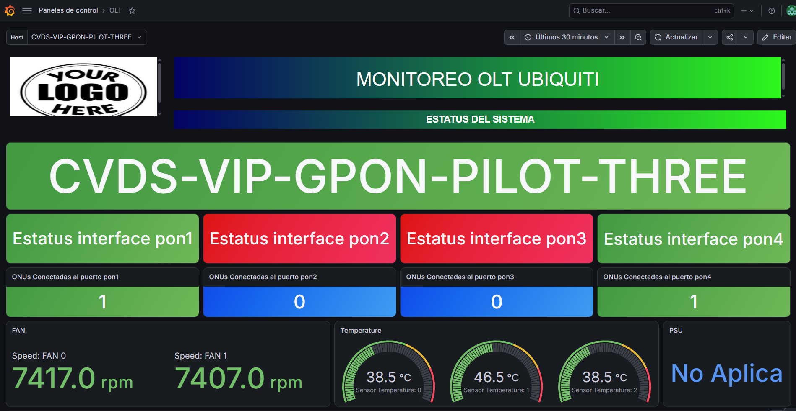
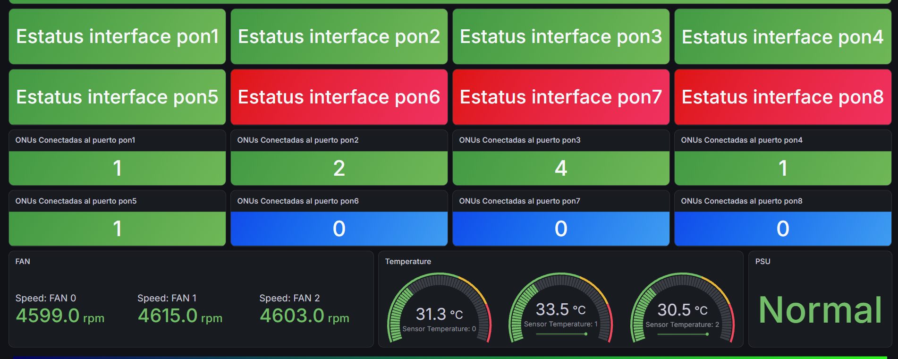
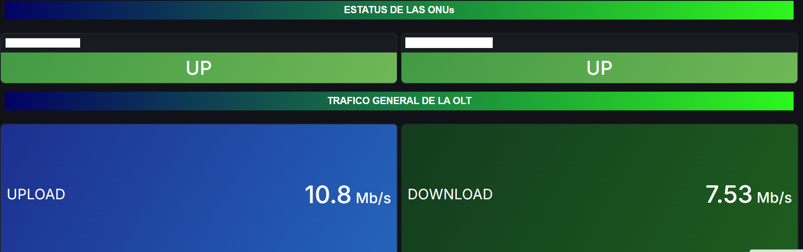

🌐 *Read this in [Spanish](README.es.md)*

# Ubiquiti UFiber OLT (4 & 8 Ports) Monitoring with Zabbix & Grafana

Zabbix template and Grafana dashboard designed to monitor **Ubiquiti UFiber OLT 4 and OLT 8** devices via **SNMPv2c**, tracking system health, PON/SFP+ interfaces, optical power levels, and connected ONUs.




OLT 8


Status ONUs


## 🛠️ Tested Compatibility

| Component | Version / Model |
| :--- | :--- |
| **Hardware** | Ubiquiti UFiber OLT 4 & OLT 8 |
| **Protocol** | SNMPv2c |
| **MIB Required** | `UBNT-UFIBER-MIB` (included) |
| **Zabbix** | 7.0.32 |
| **Grafana** | v13.3.1 |

## 📋 Included Metrics
* **System Health:** CPU utilization, memory usage, system uptime, and hardware temperature.
* **Interfaces (PON & SFP+):** Port operational status, inbound/outbound traffic bandwidth, and packet errors.
* **Optical & ONU Monitoring:** Optical signal levels (RX/TX power), connected/online ONUs count, and transceiver diagnostics.

---

## ⚙️ Prerequisites

### 1. Install the Ubiquiti MIB on the Zabbix Server
Copy the [`mibs/UBNT-UFIBER-MIB.txt`](mibs/UBNT-UFIBER-MIB.txt) file into the system MIBs directory on your Zabbix Server (or Zabbix Proxy):

```bash
cp mibs/UBNT-UFIBER-MIB.txt /usr/share/snmp/mibs/
```

*(Optional)* Ensure SNMP loads the MIB by adding `mibs +UBNT-UFIBER-MIB` to `/etc/snmp/snmp.conf`, then restart the Zabbix service:

```bash
systemctl restart zabbix-server
```

### 2. Enable SNMPv2c on the Ubiquiti OLT
1. Log in to the Ubiquiti UFiber OLT web interface (or via CLI).
2. Navigate to **Settings > System** (or **Services > SNMP**).
3. Enable **SNMP** and select version **v2c**.
4. Set your **Community String** (e.g., `public` or a custom read-only community) and save the changes.

---

## 🚀 Zabbix & Grafana Setup

1. **Zabbix (7.0.32):**
   * Import the `.yaml` template from the `zabbix/` directory via **Data collection > Templates > Import**.
   * Create or edit your OLT host, add an **SNMP interface** (port `161`, version `SNMPv2`), and configure the `{$SNMP_COMMUNITY}` macro if using a custom community string.
   * Link the imported template to the host.
2. **Grafana (v13.3.1):**
   * Import the `.json` dashboard from the `grafana/` directory via **Dashboards > New > Import** and select your Zabbix Data Source.
